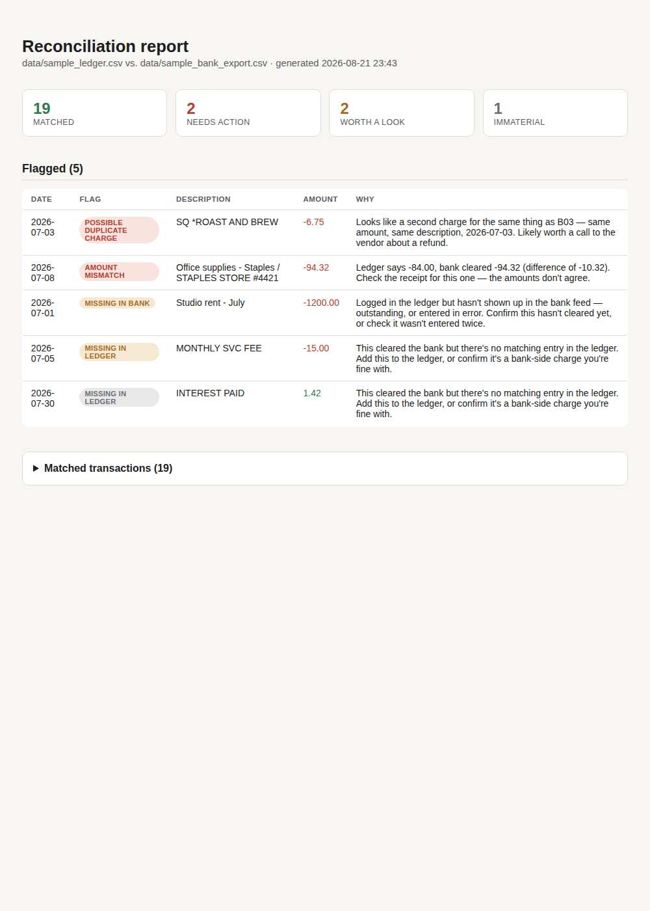

# Bank vs. Budget Reconciler

Reconciling a bank export against a manually kept ledger is one of the
most common recurring chores in a small business or back office: two
systems are supposed to agree, and someone spends an hour a month
scrolling both side by side looking for the rows that don't. This
tool does that pass in under a second and writes up *why* each
mismatch happened, not just that one exists.

Point it at two CSVs. It tells you what matched cleanly, what
needs a look, and what needs action — in plain language.



## What it actually catches

Run against the sample data included in this repo (`data/`), it finds:

- **A duplicate charge** — the same coffee shop swipe hit the bank
  twice; the ledger only has it once.
- **An amount mismatch** — an office supply run was logged at \$84.00
  but the bank cleared \$94.32.
- **A charge never logged** — a monthly bank service fee that never
  made it into the ledger.
- **An entry that hasn't cleared** — a rent check written and logged,
  with no matching bank activity yet.
- **A timing difference that *isn't* an error** — an ACH deposit
  logged on the 2nd but cleared on the 6th still matches correctly,
  instead of showing up as two separate discrepancies.

## How it decides

Matching is deterministic, on purpose — whether two rows describe the
same real transaction shouldn't change between runs. See
[`reconciler/matcher.py`](reconciler/matcher.py) for the actual logic:

1. **Pass A** — match on exact amount + date within a tolerance
   window, using description similarity to break ties (this is also
   what surfaces duplicate charges: when two bank rows both fit one
   ledger row, only the better one gets matched, and the loser gets
   flagged).
2. **Pass B** — for what's left, match on date + description even
   when the amount doesn't agree, and flag it as a mismatch instead
   of missing it as an unrelated transaction.
3. Whatever's still left over after both passes is either bank-only
   (`missing_in_ledger`) or ledger-only (`missing_in_bank`).

The LLM's job is scoped narrowly on top of that: given a flag the
matcher already decided on, write one plain-language sentence
explaining it and what to do next
([`reconciler/explainer.py`](reconciler/explainer.py)). It never
re-decides whether something matches — that keeps the tool's
core behavior testable without hitting an API, and keeps the
explanations honest about what's actually a rule-based fact versus
a judgment call.

No `ANTHROPIC_API_KEY`? The tool still runs end-to-end — flagged rows
just get a templated explanation instead of a model-written one.

## Running it

```bash
pip install -r requirements.txt
cp .env.example .env   # optional — add ANTHROPIC_API_KEY to turn on LLM explanations

python -m reconciler.cli \
  --bank data/sample_bank_export.csv \
  --ledger data/sample_ledger.csv \
  --out report.html
```

Prints a summary to the console and writes a full HTML report you can
open directly in a browser. Swap in your own two CSVs — a bank
export and whatever you track expenses in — and it works the same
way; see [`reconciler/loader.py`](reconciler/loader.py) if your
export uses a different date format or a debit/credit split instead
of a signed amount column.

## Tests

```bash
pytest
```

The test suite runs the matcher against the sample data and pins down
every planted discrepancy by name — duplicate, mismatch, missing on
each side, timing lag — so a change to the matching logic that breaks
one of these fails loudly instead of silently.

## Stack

Python, [Claude](https://docs.claude.com) for the explanation layer,
[rapidfuzz](https://github.com/rapidfuzz/RapidFuzz) for description
similarity, Jinja2 for the report. No framework for the matching
itself — at this scale a hand-written greedy matcher is easier to
reason about and test than pulling in a matching library for it.

Built with [Claude Code](https://claude.com/claude-code).

## License

MIT — see [LICENSE](LICENSE).
